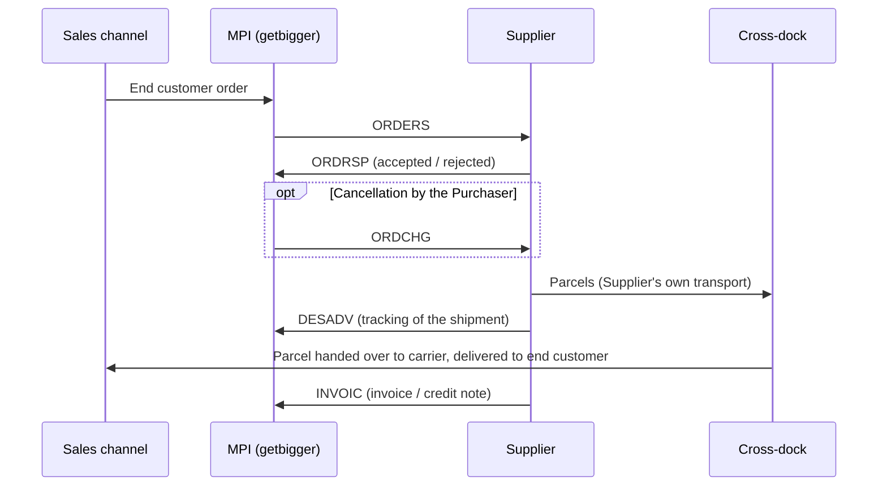

# EDI Integration Guide

This guide describes how suppliers exchange orders, order responses, despatch advices and invoices with **getbigger s.r.o.** (part of the SalesConnect group) via EDI.

It is not an API. There are no endpoints to call. All communication runs through EDI mailboxes identified by GLN numbers, and the messages are routed by the EDI service providers of both parties. This guide explains the business process, the rules each message must follow, and shows a complete example of every message.

## Quick start

- **Standard:** UN/EDIFACT EANCOM®, directory **D.01B**.
- **Orders come from us.** The key task on your side is to map all elements of the [ORDERS](messages/orders.md) example correctly.
- **You confirm orders with ORDRSP.** Based on your ORDRSP, we confirm the order to the end customer.
- **DESADV** is sent when the goods leave your warehouse for the cross-dock. It carries the tracking number and tracking URL of the shipment and switches the orders to status SHIPPING.
- **Invoices and credit notes** are sent as INVOIC.
- **Send us** the name of your EDI mailbox provider (for example ORiON/GRiT, EDITEL, Comarch EDI) and your GLN as a supplier to **tech@salesconnect.cz**.
- **Brief your EDI provider** with the request in [Getting connected](getting-connected.md#what-to-tell-your-edi-provider).

## Parties

| Term | Meaning |
|---|---|
| **Purchaser** | getbigger s.r.o., Czech Republic. Places orders and receives the Supplier's responses, despatch advices and invoices through its EDI mailbox. |
| **Supplier** | A company with a cooperation agreement with the Purchaser. Accepts orders, packs them and delivers them to the cross-dock with its own transport and at its own cost. |
| **End customer** | The buyer on a sales channel (marketplace or e-shop) for whom the order is ultimately intended. |
| **MPI** | The Purchaser's order management system. It creates, sends, receives and processes all EDI messages. |
| **Cross-dock** | The logistics location operated for the Purchaser. The Supplier delivers all orders there; from there the parcels continue to the end customers. |

## Cooperation model

All orders are delivered to the cross-dock. The Supplier never ships directly to the end customer. Transport to the cross-dock is arranged and paid by the Supplier.

1. An end customer places an order on a sales channel. MPI creates a purchase order and sends it to the Supplier as an **ORDERS** message.
2. The Supplier accepts or rejects the whole order with an **ORDRSP** message.
3. The Supplier packs each order as a separate parcel and delivers it to the cross-dock with its own transport. If several orders travel in one consolidated shipment, each parcel carries the last-mile shipping label provided in the order. Parcels sent individually are relabelled at the cross-dock.
4. On dispatch of a shipment to the cross-dock, the Supplier sends a **DESADV** message (delivery note) with the tracking number and tracking URL of that shipment. One DESADV covers all orders travelling in the same shipment, for example several orders in one consolidated shipment. On receipt of DESADV, MPI switches the orders to status SHIPPING: the orders are on their way to the cross-dock.
5. The cross-dock receives the parcels and hands them over to the carriers for delivery to the end customers.
6. The Supplier invoices the dispatched orders with an **INVOIC** message (invoice). Returns and other corrections are settled with credit notes, also sent as **INVOIC**.

The Purchaser can cancel an order before dispatch with an **ORDCHG** message.

## Messages at a glance

| Message | Direction | Purpose | Page |
|---|---|---|---|
| ORDERS | Purchaser → Supplier | Purchase order, one message per order | [ORDERS](messages/orders.md) |
| ORDRSP | Supplier → Purchaser | Acceptance or rejection of the whole order | [ORDRSP](messages/ordrsp.md) |
| ORDCHG | Purchaser → Supplier | Cancellation of the whole order | [ORDCHG](messages/ordchg.md) |
| DESADV | Supplier → Purchaser | Delivery note, confirms dispatch to the cross-dock | [DESADV](messages/desadv.md) |
| INVOIC | Supplier → Purchaser | Invoice (380) or credit note (381) | [INVOIC](messages/invoic.md) |

The messages follow the EANCOM® standard, directory **D.01B**. The examples in this guide show the XML representation processed by MPI. Each message page also lists the corresponding EANCOM segments, so that your EDI provider can map the messages to the format you use.
